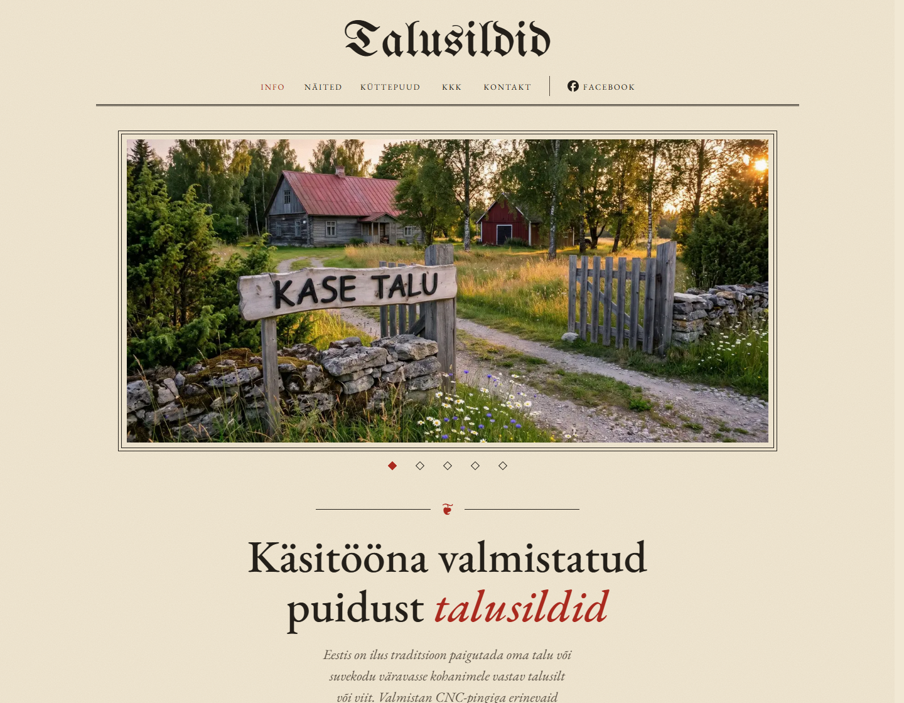

# Talusildid

The website for [Talusildid](https://talusildid.net/): handmade wooden farm signs, signposts and sauna signs with CNC-milled lettering, plus dry firewood. Made in Haapsalu and delivered across Estonia. The site is in Estonian.



## What's here

A plain static site: hand-written HTML and one stylesheet, with no build step and no JavaScript framework.

| Path | Contents |
| --- | --- |
| `index.html` | Front page: photo carousel, sign styles and prices, sizes and materials |
| `naited.html` | Examples of finished signs |
| `tahed.html` | Letter and number samples |
| `kuttepuud.html` | Firewood |
| `kkk.html` | FAQ (in Estonian and English) |
| `kontakt.html` | Contact details |
| `css/site.css` | Shared styles for every page |
| `fonts/` | Self-hosted EB Garamond and UnifrakturMaguntia |
| `images/` | Photos (WebP) and social sharing images |
| `extras/` | Design experiments, not linked from the site |

## Running it locally

Serve the folder with any static file server and open the root URL, for example:

```sh
python -m http.server 8000
```

## Deploying

Pushing to `main` deploys the site to Hostinger. Hostinger's CDN doesn't clear its cache when a file is replaced under the same name. After changing an image or `site.css`, flush the CDN in hPanel or bump the `?v=` query in the HTML.
